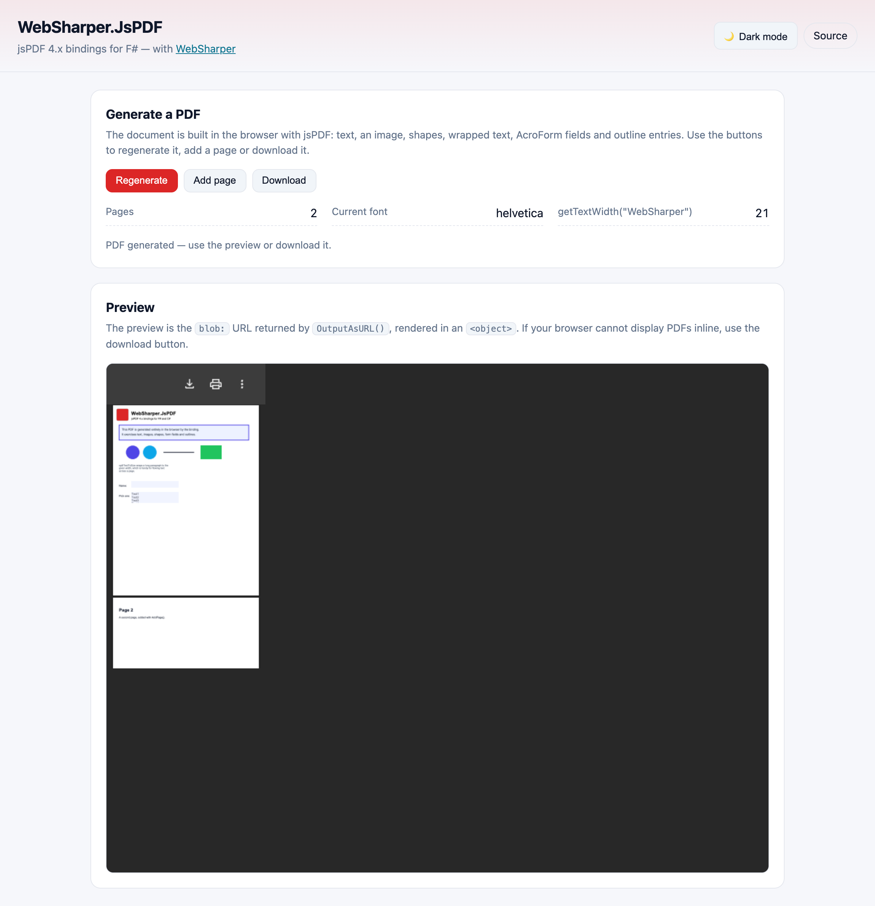

# WebSharper.JsPDF

[](https://www.nuget.org/packages/WebSharper.JsPDF)

WebSharper bindings for [jsPDF](https://github.com/parallax/jsPDF) 4.x (4.2.1+) —
client-side PDF generation for F# and C# web apps.

The binding consumes the npm package [`jspdf`](https://www.npmjs.com/package/jspdf)
as an ES module (`import jspdf from "jspdf"`) and is bundled by your toolchain
(esbuild in the sample); there is no CDN `<script>` tag.

This repository contains:

| Project | Purpose |
| --- | --- |
| `WebSharper.JsPDF` | The binding: typed F#/C# wrappers for jsPDF and its plugins (AcroForm, addImage, annotations, autoPrint, canvas/context2d, cell, html, outline, SVG, VFS, viewer preferences, XMP metadata, …). |
| `WebSharper.JsPDF.Sample` | A WebSharper SPA (esbuild → `dist/`) that builds a multi-page PDF (text, an image, shapes, wrapped text, AcroForm fields and outline entries) and previews it. |
| `WebSharper.JsPDF.Tests` | WebSharper.Testing tests for the binding. |

## Live demos

**Try it live:** [Open the sample in your browser](https://dotnet-websharper.github.io/jspdf/)



The sample doubles as the binding's [test case](#running-the-test-case): it
generates a two-page PDF with text, an image, shapes, `splitTextToSize` wrapped
text, AcroForm text/list fields and outline entries, previews the `blob:` URL
from `OutputAsURL()`, and lets you add pages and download the result. It is
light-themed by default and has a light/dark theme switcher (persisted in
`localStorage`).

- **Sample (this repository):** <https://dotnet-websharper.github.io/jspdf/>
- **Sample in the WebSharper samples gallery:** <https://websharper-samples.github.io/JsPDF/>
- **Sample source in the gallery:** <https://github.com/websharper-samples/JsPDF>
- **WebSharper:** <https://websharper.com>

## Install

```bash
dotnet add package WebSharper.JsPDF
```

Or with Paket:

```fsharp
nuget WebSharper.JsPDF
```

The package targets `netstandard2.0` and works with any WebSharper 10 or 11
project. It supports jsPDF `>= 4.2.1 < 5.0.0` (the 4.x line); jsPDF itself is
pulled from npm (`jspdf`), so the JS bundle step must resolve it (WebSharper's
SPA/esbuild build does this automatically).

## Usage

All types live in the `WebSharper.JsPDF` namespace.

### Build a document

```fsharp
open WebSharper
open WebSharper.JavaScript
open WebSharper.JsPDF

[<JavaScript>]
let CreatePdf () =
    let doc = JsPDF(JsPDFOptions(Format = PdfFormat.Letter, Unit = Unit.Mm))

    doc.SetProperties(DocumentProperties(Title = "Hello", Author = "WebSharper"))
       .SetFontSize(18.)
       .SetFont("helvetica", "bold")
       .Text("Hello, WebSharper!", 10., 20.)
       .AddPage()
       .Text("Page 2", 10., 20.)
       |> ignore

    doc.Save("document.pdf")
```

### Preview it

`OutputAsURL()` returns a `blob:` URL that you can point an `<object>`/`<iframe>` at:

```fsharp
let url = doc.OutputAsURL().ToString()
```

Other output helpers from the binding include `OutputAsBlob()`,
`OutputAsArrayBuffer()`, `OutputAsURLString()`, `OutputInNewWindow()` and
`OutputAsBool()`.

### Images, shapes and form fields

```fsharp
// An image from a data URL.
doc.AddImage(ImageOptions(dataUrl, x = 5., y = 5., width = 20, height = 20)) |> ignore

// Vector shapes.
doc.SetFillColor("#4f46e5").Circle(30., 70., 10., "F") |> ignore
doc.SetDrawColor("#0f172a").Line(75., 70., 120., 70.) |> ignore

// AcroForm fields.
doc.AddField(JsPDF.JsPDF.AcroForm.TextField(X = 10, Y = 10, Width = 60, Height = 10)) |> ignore
```

### Wrapped text and outlines

```fsharp
let lines = doc.SplitTextToSize("A long paragraph …", 90, null)
doc.Text(lines, 10., 90.) |> ignore

doc.Outline.Add(null, "Introduction", OutlineOptions(1)) |> ignore
```

### Notes on the API

- **The package is npm-based.** The binding imports the npm package as
  `"jspdf"` (lowercase). This matters on case-sensitive file systems: the
  previous `"jsPDF"` specifier only resolved on case-insensitive systems
  (macOS) and broke bundling in CI/Linux.
- **`OutputAsURL()`, `OutputAsBlob()` etc.** map to jsPDF's
  `output("bloburl"|"blob"|…)` methods.
- **`SplitTextToSize` takes three arguments** in the 4.x typings
  (`text`, `maxLen`, `options`); pass `null` for the default options.
- **`Outline` is a plugin object.** Use `doc.Outline.Add(parent, title, options)`
  rather than calling `add` on the document.
- **`TableConfig.Margins` is an object** (`TableMargins(Top = …, Bottom = …,
  Left = …, Width = …)`) in jsPDF 4.x; it was a plain number in 2.x.
- **`GetFont()` returns a `Font`** (`FontName`, `FontStyle`, `Encoding`, …), and
  `GetFontList()` returns a `Dictionary<string, string[]>`.

## Running the test case

The sample is a static SPA. Building it runs `npm install` and esbuild and emits
`dist/` at the repository root:

```bash
dotnet build WebSharper.JsPDF.Sample/WebSharper.JsPDF.Sample.fsproj -c Release
dotnet serve -d dist -p 8080
```

`dotnet serve` comes from the [`dotnet-serve`](https://github.com/dotnet-serve/dotnet-serve)
tool; install it once with `dotnet tool install -g dotnet-serve` (or use
`dotnet tool run dotnet-serve` with a local tool manifest).

Open <http://localhost:8080/>. jsPDF is fully bundled, so no network access is
needed. The preview needs a browser with a built-in PDF viewer; use the
**Download** button otherwise. The buttons drive the whole binding — use them to
verify a change end to end.

## Building from source

### Prerequisites

- [.NET SDK 11](https://dotnet.microsoft.com/download) (the WebSharper 11
  compiler needs the .NET 11 runtime).
- [Node.js](https://nodejs.org/) (for the sample's esbuild step).
- [Paket](https://fsprojects.github.io/Paket/) as a local dotnet tool (configured
  in `.config/dotnet-tools.json`).

### Restore and build

```bash
dotnet tool restore
dotnet paket restore
dotnet build WebSharper.JsPDF.sln -c Release
```

The binding targets `netstandard2.0`; the sample is a static bundle.

### Pack the NuGet package

After a Release build (so the assembly exists in `bin/Release/netstandard2.0`):

```bash
dotnet paket pack ./out
```

## Deployment

Pushing to `main` triggers `.github/workflows/ghpages.yml`, which builds the
sample in Release and publishes `dist/` to the `gh-pages` branch via GitHub
Pages.

## Repository layout

```
WebSharper.JsPDF/                # the binding (WIG definitions)
  Main.fs
WebSharper.JsPDF.Sample/         # static SPA demo / test case
  Client.fs
  index.html
  site.css
  esbuild.config.mjs
  wsconfig.json
WebSharper.JsPDF.Tests/          # WebSharper.Testing tests
docs/
  sample.png                     # screenshot of the running sample
nuget/                           # Paket pack template
.github/workflows/ghpages.yml    # build + deploy the sample
```

## License

Apache 2.0 — see [LICENSE.md](LICENSE.md).
